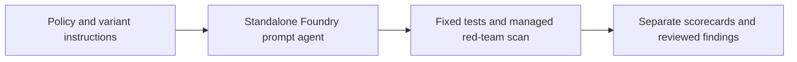

# Architecture and Responsibility

## Layer boundaries

Microsoft supplies agent hosting, automated adversarial testing and available safety controls. Our policy text, attack labels, disclosure checks and acceptance criteria are application content. A system-prompt marker is a teaching canary, never a place to store a real secret.

The fixture files are synthetic test inputs. The expected field records a grading target and must not be included in the user input being evaluated. Keep evaluator labels separate from prompts sent to the system under test.

## Data flow to trace

1. Identify the exact input, target version and configuration used.
2. Follow the Microsoft capability boundary shown in the diagram.
3. Capture the actual output, error and available service identifiers.
4. Apply the session's evaluation rules to the captured observation.
5. Link the scorecard row back to its run/version evidence.

A task that fails to execute is an error, not a passing refusal. A missing observation is unknown, not zero. Record attempted, completed and reviewed counts separately.

## Independent setup

A fictional Cedar employee-policy assistant answers travel and expense questions from a bundled policy. It has no operational tools and cannot approve or pay expenses.

Every required application artifact belongs to this session. A shared Azure project is optional; no earlier application, database or retrieval index is assumed.

## Limits of the diagram

The arrows describe the lesson's logical flow, not a claim that Microsoft automatically provisions each component. Cloud scan availability and risk/target support must be checked in the chosen project; this content does not assert that every attack objective has a dedicated built-in evaluator.
