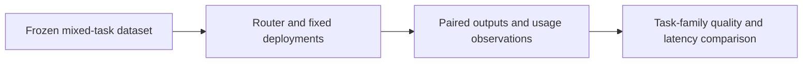

# Architecture and Responsibility

## Layer boundaries

Foundry provides routing and inference. Our benchmark labels, grading rules, measurement harness and supplied price table define the experiment. Report the response's available model metadata; never infer the hidden routing decision from answer style.

The fixture files are synthetic test inputs. The expected field records a grading target and must not be included in the user input being evaluated. Keep evaluator labels separate from prompts sent to the system under test.

## Data flow to trace

1. Identify the exact input, target version and configuration used.
2. Follow the Microsoft capability boundary shown in the diagram.
3. Capture the actual output, error and available service identifiers.
4. Apply the session's evaluation rules to the captured observation.
5. Link the scorecard row back to its run/version evidence.

A task that fails to execute is an error, not a passing refusal. A missing observation is unknown, not zero. Record attempted, completed and reviewed counts separately.

## Independent setup

A fictional Birch service desk classifies tickets, extracts fields and explains short support policies. A mixed-task benchmark compares a router deployment with fixed-model baselines.

Every required application artifact belongs to this session. A shared Azure project is optional; no earlier application, database or retrieval index is assumed.

## Limits of the diagram

The arrows describe the lesson's logical flow, not a claim that Microsoft automatically provisions each component. Router versions, underlying models, parameter support and region availability change. Confirm these for the selected deployment; no particular model family is required by this lab.
