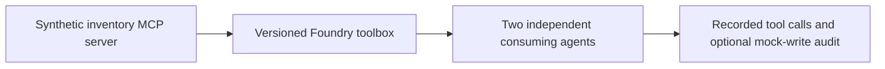

# Architecture and Responsibility

## Layer boundaries

Foundry supplies the toolbox resource and supported MCP integration. The MCP server must implement validation, stock constraints, authorization and idempotency. An agent approval prompt is not a substitute for backend authorization.

The fixture files are synthetic test inputs. The expected field records a grading target and must not be included in the user input being evaluated. Keep evaluator labels separate from prompts sent to the system under test.

## Data flow to trace

1. Identify the exact input, target version and configuration used.
2. Follow the Microsoft capability boundary shown in the diagram.
3. Capture the actual output, error and available service identifiers.
4. Apply the session's evaluation rules to the captured observation.
5. Link the scorecard row back to its run/version evidence.

A task that fails to execute is an error, not a passing refusal. A missing observation is unknown, not zero. Record attempted, completed and reviewed counts separately.

## Independent setup

A fictional Juniper supply assistant checks a synthetic inventory catalog and optionally proposes a stock reservation. Inventory reads are real calls to a demo MCP server; reservations remain mock records.

Every required application artifact belongs to this session. A shared Azure project is optional; no earlier application, database or retrieval index is assumed.

## Limits of the diagram

The arrows describe the lesson's logical flow, not a claim that Microsoft automatically provisions each component. Tool support varies by model/region. The write extension is optional and requires an implemented, authenticated demo server; no MCP server is deployed by these content files.
