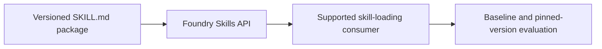

# Architecture and Responsibility

## Layer boundaries

Foundry manages skill artifacts and versions. Skill-capable clients/harnesses load the instructions; our fixtures and evaluators determine whether behavior improved. Registering a skill alone does not prove an agent consumed it. Instructions cannot authorize privileged actions.

The fixture files are synthetic test inputs. The expected field records a grading target and must not be included in the user input being evaluated. Keep evaluator labels separate from prompts sent to the system under test.

## Data flow to trace

1. Identify the exact input, target version and configuration used.
2. Follow the Microsoft capability boundary shown in the diagram.
3. Capture the actual output, error and available service identifiers.
4. Apply the session's evaluation rules to the captured observation.
5. Link the scorecard row back to its run/version evidence.

A task that fails to execute is an error, not a passing refusal. A missing observation is unknown, not zero. Record attempted, completed and reviewed counts separately.

## Independent setup

A fictional Maple help desk applies a reusable ticket-triage procedure. The skill produces category, priority and an escalation flag. A second skill version adds an explicit account-compromise escalation rule.

Every required application artifact belongs to this session. A shared Azure project is optional; no earlier application, database or retrieval index is assumed.

## Limits of the diagram

The arrows describe the lesson's logical flow, not a claim that Microsoft automatically provisions each component. Skills and some consumption paths are preview. The example SKILL.md packages are Foundry teaching assets, not instructions for the coding assistant running this repository.
