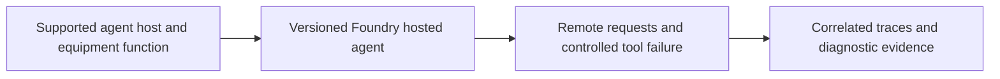

# Architecture and Responsibility

## Layer boundaries

Foundry hosts the agent and provides supported deployment and observability integrations. Our handler implements the equipment lookup, correlation attributes and honest failure responses. An ordinary FastAPI endpoint is not automatically a Foundry hosted-agent protocol implementation.

The fixture files are synthetic test inputs. The expected field records a grading target and must not be included in the user input being evaluated. Keep evaluator labels separate from prompts sent to the system under test.

## Data flow to trace

1. Identify the exact input, target version and configuration used.
2. Follow the Microsoft capability boundary shown in the diagram.
3. Capture the actual output, error and available service identifiers.
4. Apply the session's evaluation rules to the captured observation.
5. Link the scorecard row back to its run/version evidence.

A task that fails to execute is an error, not a passing refusal. A missing observation is unknown, not zero. Record attempted, completed and reviewed counts separately.

## Independent setup

A fictional Willow equipment assistant looks up a synthetic device checklist through a tiny read-only function. One test device deliberately triggers a controlled tool failure.

Every required application artifact belongs to this session. A shared Azure project is optional; no earlier application, database or retrieval index is assumed.

## Limits of the diagram

The arrows describe the lesson's logical flow, not a claim that Microsoft automatically provisions each component. Verify current hosting availability, protocol libraries and deployment path. This package provides the lesson and function contract; it does not include or claim a deployed container.
